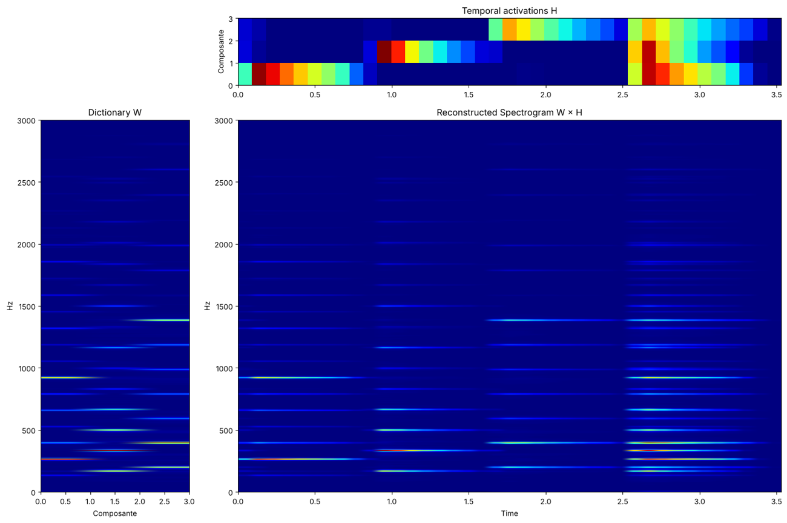
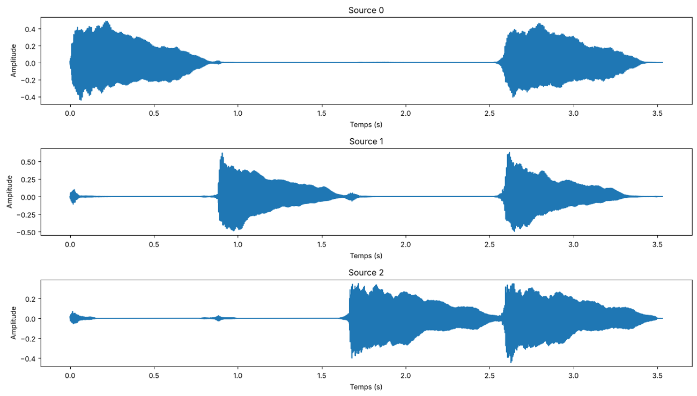
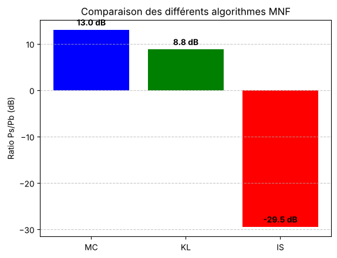

# Séparation de sources sonores par NMF

Séparer les différentes sources d'un enregistrement audio **mono**, par exemple les notes d'un piano joué en accord, grâce à l'analyse temps-fréquence et à la **factorisation en matrices non négatives (NMF)**.

Projet intégratif réalisé en équipe de 4 à l'INSA Rouen Normandie (décembre 2025), en **Python**.



*Enregistrement de piano décomposé en 3 sources : à gauche, le dictionnaire spectral D (la « signature » de chaque note) ; en haut, les activations A (le moment où chaque note est jouée) ; au centre, le spectrogramme reconstruit D × A.*

---

## Fonctionnement

```
signal audio ──> STFT ──> spectrogramme M ──> NMF : M ≈ D × A ──> masquage ──> iSTFT ──> sources séparées
```

1. **Transformation temps-fréquence** : la STFT (transformée de Fourier à court terme) découpe le signal en fenêtres qui se chevauchent (fenêtre de Hann ou de Gauss) et donne le spectrogramme d'amplitude **M**.
2. **Factorisation** : M est approchée par le produit de deux matrices positives, **M ≈ D × A** :
   - **D** est le dictionnaire spectral (une colonne par source) ;
   - **A** contient les activations, c'est-à-dire quand et avec quelle intensité chaque source est présente.
3. **Reconstruction** : chaque source est isolée par un masque appliqué au spectrogramme, puis ramenée dans le domaine temporel par STFT inverse (iSTFT).

## Ce qui a été implémenté

- **STFT** avec SciPy et comparaison de deux fenêtres (Hann et Gauss), avec un calcul automatique des paramètres.
- **NMF avec scikit-learn**, puis **réimplémentée à la main** avec trois fonctions de coût :
  - **moindres carrés alternés** (solution analytique à chaque étape) ;
  - divergence de **Kullback-Leibler** (mises à jour multiplicatives) ;
  - divergence d'**Itakura-Saito** (mises à jour multiplicatives).
- **Comparaison des méthodes** avec le rapport puissance du signal / puissance de l'erreur (en dB).
- **Choix automatique du nombre de sources** k par la méthode du coude sur l'erreur de reconstruction.

## Résultats

**Les 3 notes du piano, séparées et ramenées dans le domaine temporel :**



**Comparaison des trois fonctions de coût sur l'enregistrement de piano :**



- Les **moindres carrés** donnent la meilleure reconstruction globale (13 dB sur le piano).
- **Kullback-Leibler** est un bon compromis entre qualité et stabilité numérique.
- **Itakura-Saito** obtient un score plus faible, car elle privilégie les détails des sons faibles plutôt que l'énergie globale du signal.

Le rapport complet, avec toutes les explications et les tests sur trois enregistrements (piano, cris d'animaux, extrait de Bach), est dans [`notebooks/Rapport_Final.ipynb`](notebooks/Rapport_Final.ipynb). Les diapositives de la soutenance sont dans [`docs/presentation.pdf`](docs/presentation.pdf).

## Lancer le projet

```bash
git clone https://github.com/hadi56a/audio-source-separation-nmf.git
cd audio-source-separation-nmf
python3 -m venv venv
source venv/bin/activate
pip install -r requirements.txt
jupyter notebook notebooks/Rapport_Final.ipynb
```

Le notebook s'exécute entièrement en une minute environ. Les sources séparées peuvent être écoutées directement dans Jupyter.

## Structure

```
├── notebooks/
│   └── Rapport_Final.ipynb   rapport complet et exécutable
├── src/
│   ├── STFT.py               STFT (Hann, Gauss) et calcul des paramètres
│   ├── calculDA.py           calcul de D et A : NMF, moindres carrés, Kullback-Leibler, Itakura-Saito
│   ├── recomposition.py      reconstruction des sources (masquage + iSTFT)
│   └── affichage.py          spectrogrammes et signaux
├── data/                     enregistrements audio de test
├── docs/                     présentation et images du README
└── requirements.txt
```

## Technologies

Python, NumPy, SciPy, scikit-learn, Matplotlib, Jupyter.

## Équipe

Léandre Lacroix, Ilan Mathieu, Hadi Assi et Maïssa Ben Sethoum.
